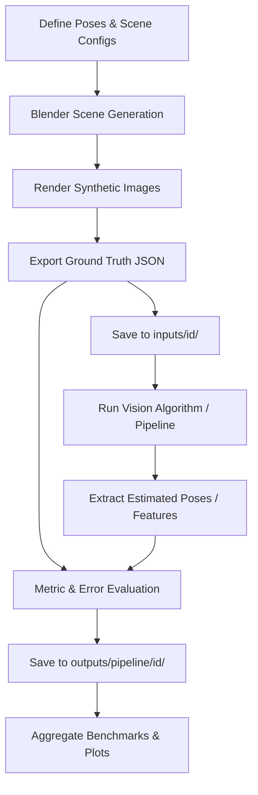

# Synthetic Testing Framework: Blender & OpenCV Pipelines

## 1. Overview
This framework defines a decoupled, reproducible methodology for testing and validating computer vision algorithms (such as fiducial marker tracking, feature detection, camera pose estimation, and stereo reconstruction) using Blender as a ground-truth simulation environment.

---

## 2. Directory Layout Architecture

To allow re-running, iterating on detector parameters, or comparing alternate algorithmic pipelines without re-rendering scenes, directory storage  is separated into **inputs**, **outputs**, and **artifacts**:

```text
experiment/
├── <id>_<experiment_family>/       # e.g., 01_can_triangulation, 02_can_rel_to_marker, ...
│   ├── shared/                     # Shared textures, meshes, labels, marker templates
│   ├── reports/                    # Summaries, reports, patterns observed, summarizer scripts
│   │   ├── summary.csv
│   │   ├── summary.json
│   │   ├── PATTERNS_OBSERVED.md
│   │   └── summarize.py
│   └── <scene_id>/                 # Individual experiment scene run (001, 002, ...)
│       ├── inputs/                 # Frozen scene inputs (render once)
│       │   ├── ground_truth.json   # True object coordinates, camera poses, intrinsics
│       │   ├── scene_spec.json     # Configuration parameters
│       │   ├── cam0_render.png     # Rendered camera 0 frame
│       │   └── cam1_render.png     # Rendered camera 1 frame
│       ├── artifacts/              # Scene-specific generation assets
│       │   ├── scene.blend         # Saved Blender 3D scene
│       │   └── build_scene.py      # Reproducible scene generation script
│       └── outputs/                # Vision algorithm evaluation results
│           └── <methodology>/      # e.g., yolo_triangulation, contour_triangulation
│               ├── cam0_annotated.png
│               ├── cam1_annotated.png
│               └── report.json     # Detected 2D boxes, 3D triangulated coordinates, error analysis
```

> [!IMPORTANT]
> **Experiment Ordering & Naming Rule:**
> Experiment families must be sequentially prefixed with two-digit identifiers based on their creation order: `01_<name>`, `02_<name>`, `03_<name>`, etc. This ensures strict chronological ordering, traceability, and effortless indexing across benchmarks.

---

## 3. General Testing Workflow



### Stage 1: Scene Generation & Ground Truth Export (`inputs/`)
1. **Camera Modeling:**
   - Configure camera intrinsics (focal length $f_x, f_y$, principal point $c_x, c_y$, image resolution, sensor size) matching pinhole or calibrated lens models.
2. **Object & Scene Placement:**
   - Place targets, textures, and camera rigs with known metric translations and Euler/quaternion rotations.
3. **Rendering & Export:**
   - Render camera images using standard, consistent view transforms and emission shaders (to avoid lighting/shading color bias).
   - Export world matrices, camera extrinsics, and metric target positions into a frozen `ground_truth.json`.

### Stage 2: Algorithmic Processing (`outputs/<pipeline_variant>/`)
1. **Detection & Estimation:**
   - Read the frozen rendered images from `inputs/<id>/`.
   - Execute the target computer vision pipeline (feature matching, marker detection, PnP pose estimation, relative pose estimation).
2. **Coordinate System Alignment:**
   - Convert between Blender conventions (typically right-handed $+Z$ up, looking along local $-Z$) and OpenCV conventions (right-handed $+Y$ down, looking along $+Z$).
3. **Validation & Metrics Calculation:**
   - Compare estimated parameters $\mathbf{\hat{\theta}}$ against ground-truth parameters $\mathbf{\theta}^*$:
     - **Translation Error:** $\|\mathbf{t}_{\text{est}} - \mathbf{t}_{\text{gt}}\|_2$ (metric distance)
     - **Distance Residual:** $|\|\mathbf{t}_{\text{est}}\| - \|\mathbf{t}_{\text{gt}}\||$
     - **Rotation Error:** $\theta_{\text{err}} = \arccos\left(\frac{\text{Tr}(\mathbf{R}_{\text{est}} \mathbf{R}_{\text{gt}}^\top) - 1}{2}\right)$ (geodesic angular difference)
   - Compare against acceptance thresholds (e.g. maximum translation residual, maximum angular discrepancy) and assign `pass`/`fail`.
4. **Visualization:**
   - Render annotated debug overlays (detection outlines, projected 3D coordinate frame axes) and write a per-scene `report.json`.

### Stage 3: Aggregation & Analysis (`artifacts/`)
- Aggregate results across scenes into `summary.csv` and `summary.json`.
- Plot pass rates, translation/rotation error distributions, and runtimes across parameter variations or library versions.
